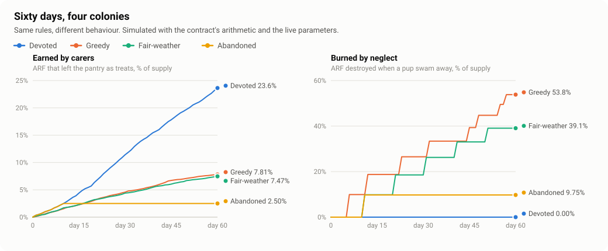

# Sixty days, four colonies

Generated by `node scripts/sim.mjs` (deterministic, no network). It replays the contract's
arithmetic with the `live` parameters from `scripts/presets.mjs` in 5-minute steps.

| Colony | What they do | Earned | Burned | Left in pantry | Pups | Longest life | Fish | Laughs | Fees to the colony |
| --- | --- | ---: | ---: | ---: | ---: | ---: | ---: | ---: | ---: |
| Devoted | Someone is always around. He is fed as soon as his belly drops below 60%, and hears about 12 good jokes a day. | 23.63% | 0.00% | 76.37% | 1 | 60.0 days | 877 | 758 | 20.14 NEAR |
| Greedy | Everyone waits for the biggest treat: nobody feeds him above 12% belly, and below that someone shows up only one time in five. Two jokes a day. | 7.81% | 53.81% | 38.38% | 9 | 13.5 days | 555 | 130 | 7.50 NEAR |
| Fair-weather | A lively colony from 08:00 to midnight that tops him up before bed, and nobody at all for eight hours every night. | 7.47% | 39.07% | 53.46% | 6 | 10.0 days | 606 | 327 | 10.96 NEAR |
| Abandoned | Devoted for ten days, then everybody leaves for good. | 2.50% | 9.75% | 87.75% | 1 | 10.3 days | 99 | 130 | 2.94 NEAR |

Day-by-day numbers are in [sim.csv](sim.csv).

## What the numbers say

- **Care is the only way supply enters circulation.** Nothing is ever minted: ARF moves from the
  pantry to carers, or is destroyed.
- **Waiting pays the individual and costs the colony.** The greedy colony earns more per fish
  (the treat grows with the square of his hunger) and still loses pups, and each loss burns 10% of
  what is left.
- **An older pup needs a more attentive colony.** His belly empties 5% faster per day of age, so a
  colony that sleeps eight hours can raise a young pup and then starts losing him. That is what
  resets the fair-weather colony again and again.
- **An abandoned floe burns once, not forever.** After the pup leaves, the pantry is untouched until
  somebody calls a new pup.
- Rewards are a share of what is left in the pantry, so emission slows by itself as the pantry
  empties. It never reaches zero and never needs a halving schedule.
